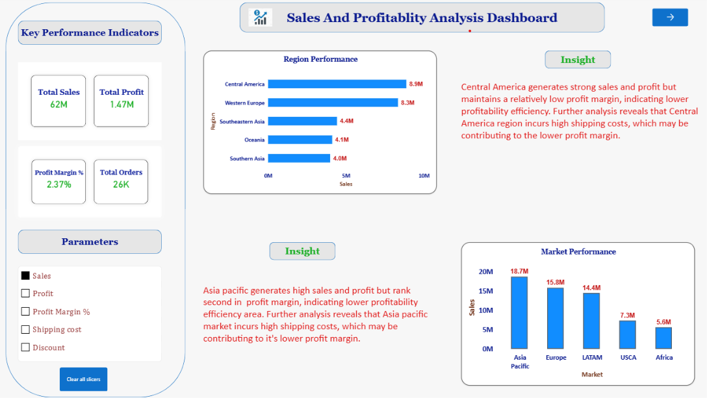
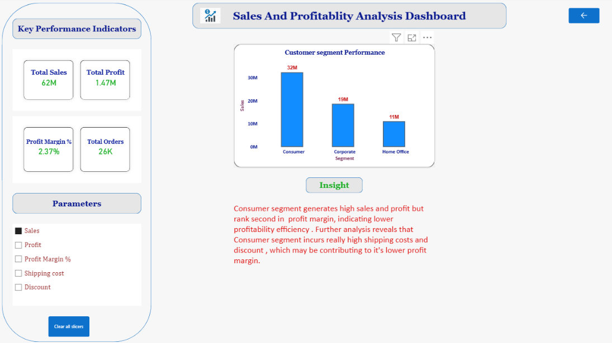

# Sales and Profitability Analysis | MySQL & Power BI

## Tools & Technologies

| Category | Tools / Technologies |
|---|---|
| Programming & Data Preparation | Python, Jupyter Notebook |
| Database | MySQL |
| Query Language | SQL |
| Data Visualization | Power BI |
| Calculations & Measures | DAX |
| Data Modeling Approach | Star Schema |
| Data Source | Kaggle |

## Project Overview

This project focuses on analyzing the company's sales and profitability performance to identify the factors contributing to declining profit margins despite consistent growth in sales and total profit.

Using **Python, MySQL, SQL, and Power BI**, I performed data preparation, database management, data modeling, and business-focused analysis. I developed an interactive Power BI dashboard to evaluate performance across different products, categories, sub-categories, regions, markets, customers, and customer segments.

The primary goal was to identify high-sales but low-margin business areas, investigate the possible impact of discounts and shipping costs, and provide actionable recommendations to improve profitability.

---

## 1. Business Problem

A retail company was experiencing consistent growth in sales and total profit. However, its overall profit margin was declining over time.

This indicated that the company was generating more sales, but profitability was not improving at the same pace. Management needed to understand which business areas were contributing to this decline and identify the factors putting pressure on profit margins.

The company required a data-driven approach to evaluate its sales and profitability performance and support better business decisions.

## 2. Project Objectives

My objective was to analyze the company's sales and profitability data and develop an interactive dashboard to help management understand business performance.

The analysis focused on answering the following business questions:

1. How have Sales, Profit, and Profit Margin changed over time?
2. Which product categories and sub-categories generate the highest and lowest profit margins?
3. Which regions and markets contribute the most to sales and profitability?
4. Which customer segments and customers generate higher sales but comparatively lower profit margins?
5. Which business areas have high sales but low profitability?
6. How are discounts and shipping costs affecting overall profitability?
7. What actions can the company take to improve profit margins while maintaining sales growth?

**Key Performance Indicators (KPIs):**

- Total Sales
- Total Profit
- Total Orders
- Profit Margin

## 3.Technical Implementation

To achieve these objectives, I followed a structured data analytics workflow, starting with data preparation and ending with an interactive Power BI dashboard.

### 3.1 Data Source

- **Source:** Kaggle
- **Dataset:** Retail Sales Dataset
- **Tables:** Orders, Returns, and People

I used these datasets to analyze sales transactions, profitability, product performance, customer segments, and regional performance.

### 3.2 Data Import and Database Setup

- Used Python in Jupyter Notebook to import the dataset.
- Created a database in MySQL.
- Imported the Orders, Returns, and People tables into MySQL.
- Prepared the database for further cleaning, transformation, and SQL analysis.

### 3.3 Data Cleaning

Performed basic data cleaning in MySQL to improve data quality and ensure reliable analysis.

Key cleaning activities included:

- Checked and corrected column data types, including converting Shipping Cost into an integer data type.
- Identified and handled missing and NULL values.
- Replaced missing Postal Code values with "Unknown" where appropriate.
- Checked and handled duplicate records.
- Identified and addressed inconsistent data.

### 3.4 Data Transformation

Created a **Revenue** column to calculate the revenue generated from each transaction.

**Revenue = Quantity × Price**

This additional column helped analyze sales performance across different products, categories, regions, and customer segments.

### 3.5 Data Modeling – Star Schema

Designed a Star Schema to organize the data into a structured format for analytical reporting.

- Organized the data using a central fact table and related dimension tables.
- Structured the model to support analysis across different business dimensions.
- Used the Star Schema approach to make the data more suitable for reporting and analysis.

### 3.6 SQL Analysis

Used MySQL to write SQL queries based on the defined business questions.

The analysis focused on:

- Evaluating sales, profit, and profit margin trends over time.
- Identifying high-performing and low-performing product categories and sub-categories.
- Comparing sales and profitability across regions and markets.
- Analyzing customer and customer-segment performance.
- Identifying high-sales but low-margin business areas.
- Examining discounts and shipping costs to understand their possible impact on profitability.

### 3.7 Power BI Integration

Connected Power BI directly to the MySQL database using the database connector to access the prepared data for dashboard development.

### 3.8 DAX Measures and KPI Development

Created DAX measures to calculate the key performance indicators required for the dashboard.

The following KPIs were developed:

- **Total Sales:** Measures the overall sales generated by the company.
- **Total Profit:** Measures the total profit generated.
- **Total Orders:** Measures the number of orders.
- **Profit Margin:** Evaluates profitability relative to sales.

### 3.9 Dashboard Development

Developed an interactive Power BI dashboard to present the analysis in an easy-to-understand visual format.

**Dashboard features included:**

- KPI cards to display Total Sales, Total Profit, Total Orders, and Profit Margin.
- Trend analysis to monitor Sales, Profit, and Profit Margin over time.
- Category and sub-category analysis to compare profitability.
- Regional and market analysis to evaluate business performance.
- Customer and customer-segment analysis to identify profitability patterns.
- A dynamic Field Parameter to switch between Sales, Profit, Profit Margin, Shipping Cost, and Discount.
- Interactive slicers to filter and explore the data.

## 4. Key Insights & Business Recommendations

After analyzing the data and developing the dashboard, I identified the following business insights:

### Insight 1: Sales and Profit Growth vs. Declining Profit Margin

**Finding:**

Sales and total profit showed an increasing trend over the four-year period, while the overall profit margin declined.

This indicated that the company was generating higher sales and profit, but its profitability was not improving at the same pace.

**Business Recommendation:**

Management should monitor profit margins alongside sales growth and investigate the business areas contributing to margin decline. Focus should be placed on improving profitability rather than relying only on increasing sales.

### Insight 2: Category and Sub-category Profitability

**Finding:**

The analysis highlighted comparatively lower profit margins in certain product categories and sub-categories, including areas within Office Supplies and Art, despite their contribution to sales and profit.

**Business Recommendation:**

Review pricing and discount strategies for low-margin products. Management should also evaluate shipping expenses and product-level costs to identify opportunities for improving profitability.

### Insight 3: Regional Sales and Profitability

**Finding:**

Central America demonstrated strong sales and profit performance but comparatively lower profit margins. Higher shipping costs were identified as a possible factor putting pressure on profitability.

**Business Recommendation:**

Management should review shipping and logistics expenses in this region. Optimizing delivery operations and evaluating pricing strategies may help improve regional profit margins.

### Insight 4: Market Performance

**Finding:**

Asia Pacific generated high sales and profit but ranked second in terms of profit margin. This indicated that strong sales performance did not necessarily translate into the highest profitability.

**Business Recommendation:**

Evaluate the impact of shipping costs, discounts, and other expenses across the market. Focus on improving cost efficiency while maintaining sales performance.

### Insight 5: Customer Segment Performance

**Finding:**

The Consumer segment generated the highest sales and profit but ranked second in profit margin. This suggested that higher sales contribution did not necessarily result in the strongest margin performance.

**Business Recommendation:**

Review discount patterns and shipping expenses associated with the Consumer segment. Identify opportunities to improve margins without negatively affecting customer demand.

## 5. Business Impact

The project provided a consolidated view of the company's sales and profitability performance through an interactive Power BI dashboard.

Key outcomes included:

- Identified the gap between increasing sales and profit and declining profit margins.
- Highlighted product categories, sub-categories, regions, markets, and customer segments requiring further profitability analysis.
- Identified discounts and shipping costs as important areas to investigate for potential margin improvement.
- Enabled management to compare business performance across multiple dimensions.
- Provided data-driven recommendations to support better pricing, discount, and shipping-cost decisions.
- Created an interactive reporting solution to support ongoing sales and profitability monitoring.

## 6. Author

**Krishna Belwal**

- **Domain:** Retail Analytics | Sales & Profitability Analysis
- **Tools:** Python, MySQL, SQL, Power BI, DAX
- **Project Category:** Data Analytics
- **Project Type:** End-to-End Data Analytics Project

