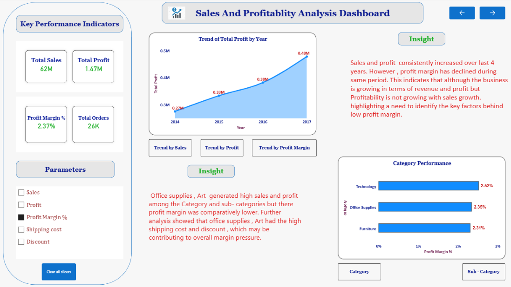

# Sales and Profitability Analysis | MySQL & Power BI

## 1. Project Overview

The primary objective of this project is to analyze the company's sales and profitability performance to identify the key factors contributing to declining profit margins despite consistent growth in sales and total profit.

Using **MySQL** for database management, basic data cleaning, star schema creation, and SQL-based business analysis, **Python** for data import, and **Power BI** for interactive dashboard development, this project explores sales and profitability across different regions, markets, product categories, sub-categories, and customer segments.

The analysis focuses on identifying high-revenue but low-margin business areas and understanding how discounts and shipping costs influence overall profitability.

## 2. Tools & Technologies

- **Python (Jupyter Notebook):** Importing dataset into MySQL.
- **MySQL:** Database creation, basic data cleaning, star schema creation, and SQL-based business analysis.
- **Power BI:** Interactive dashboard development and data visualization.
- **DAX:** Creation of measures for calculating key business KPIs.
- **Star Schema**: Organizing data into fact and dimension tables to establish a structured analytical data model.

## 3. Business Requirements

### 3.1 Business Questions

The analysis was guided by the following business questions:

1. How have Sales, Profit, and Profit Margin performed over time?
2. Which product categories and sub-categories are affecting overall profitability?
3. How do sales and profitability vary across different regions and markets?
4. Which customer segments and customers contribute to lower profit margins?
5. Which business areas generate high sales but relatively low profit margins?
6. How do discounts and shipping costs affect overall profitability?

### 3.2 Key Performance Indicators (KPIs)

| KPI | Purpose |
|---|---|
| Total Sales | Measures overall revenue generated. |
| Total Profit | Measures overall profit generated. |
| Total Orders | Tracks the total number of orders. |
| Profit Margin | Measures profitability relative to sales. |

## 4. Project Workflow

### 4.1 Data Source

- Downloaded the Sales and Profitability dataset from Kaggle.
- The dataset consists of three tables:

| Table | Description |
|---|---|
| Orders | Contains order-level details, including sales, profit, products, customers, discounts, and shipping costs. |
| Returns | Contains information about returned orders. |
| People | Contains regional manager information. |

### 4.2 Database Creation and Data Import

Used **Jupyter Notebook** to import the dataset into MySQL.

**Activities performed:**
- Downloaded the Kaggle dataset.
- Created a database in MySQL.
- Imported all three tables into MySQL using Python.
- Created a star schema to organize the data and establish relationships between the tables.

### 4.3 Data Cleaning

Performed basic data quality checks to ensure the dataset was suitable for analysis.

**Activities performed:**
- Checked column data types.
- Identified and handled missing and NULL values.
- Replaced missing postal codes with "Unknown" where applicable.
- Checked for duplicate records.

### 4.4 SQL Data Analysis

Wrote SQL queries based on the defined business questions to analyze sales, profit, and profit margin across different business dimensions.

The analysis focused on identifying profitability trends, comparing business performance, and investigating factors contributing to lower profit margins.

### 4.5 Power BI Integration

Connected Power BI directly to the MySQL database using the MySQL database connector and imported the required data for dashboard development.

### 4.6 DAX Measures

Created four DAX measures to calculate the primary business KPIs displayed on the dashboard.

| DAX Measure | Purpose |
|---|---|
| Total Sales | Calculates total sales revenue. |
| Total Profit | Calculates total profit generated. |
| Total Orders | Calculates the total number of orders. |
| Profit Margin | Calculates profit as a percentage of total sales. |

### 4.7 Power BI Dashboard Development

Developed an interactive **Sales and Profitability Analysis Dashboard** to present business performance and profitability insights in a structured and easy-to-understand format.

**KPI Cards**

The dashboard includes four primary KPI cards:
- Total Sales
- Total Profit
- Total Orders
- Profit Margin

**Visualizations**

The dashboard uses different visualizations to compare business performance across time, regions, product categories, sub-categories, and customer segments.

**Dynamic Field Parameters**

Created a custom field parameter in Power BI to dynamically switch between the following business metrics:

- Sales
- Profit
- Profit Margin
- Shipping Cost
- Discount

This allows users to compare different business metrics within the same visualizations without creating separate charts for each measure.

**Interactive Slicers**

Added interactive slicers to enable users to filter and explore dashboard data across different business dimensions.

---

## 5. Key Insights & Business Recommendations

The following insights were derived from the SQL analysis and Power BI dashboard.

### 1. Overall Sales and Profitability Trends

- **Insight:** Sales and total profit consistently increased over the four-year period. However, profit margin declined during the same period, indicating that profitability was not growing at the same pace as revenue.
- **Business Recommendation:** Management should regularly monitor profit margins alongside sales growth and investigate the underlying factors contributing to declining profitability.

### 2. Category and Sub-Category Profitability

- **Insight:** Office Supplies and Art generated comparatively strong sales and profit. However, their profit margins were relatively lower. Further analysis indicated that higher shipping costs and discounts may be contributing to margin pressure.
- **Business Recommendation:** Review discount policies and shipping expenses across these categories. Focus on optimizing shipping costs and evaluating discount strategies to improve profit margins.

### 3. Regional Profitability

- **Insight:** Central America generated strong sales and profit but maintained a relatively low profit margin, indicating lower profitability efficiency. Further analysis revealed comparatively high shipping costs in the region.
- **Business Recommendation:** Evaluate regional shipping expenses, optimize delivery operations, and review pricing strategies to improve regional profitability.

### 4. Market-wise Profitability

- **Insight:** Asia Pacific generated high sales and profit but ranked second in profit margin, indicating an opportunity to improve profitability. Higher shipping costs may be contributing to additional margin pressure.
- **Business Recommendation:** Review shipping arrangements and logistics expenses in the Asia Pacific market to identify opportunities for cost optimization.

### 5. Customer Segment Profitability

- **Insight:** The Consumer segment generated the highest sales and profit but ranked second in profit margin. Higher discounts and shipping costs may be contributing to lower profitability efficiency.
- **Business Recommendation:** Review discount strategies and shipping expenses for the Consumer segment. Focus on improving order profitability while maintaining customer retention and sales growth.

---

## 6. Business Impact

- Identified the declining profit margin trend despite consistent growth in sales and total profit.
- Highlighted product categories, regions, markets, and customer segments requiring further profitability investigation.
- Identified shipping costs and discounts as potential contributors to lower profit margins.
- Provided data-driven recommendations to support better pricing, discount management, and shipping cost optimization.
- Developed an interactive dashboard to help management monitor sales and profitability performance.

## 7. Author

**Krishna Belwal**

- **Domain:** Retail Analytics / Sales & Profitability Analysis
- **Tools & Technologies:** Python, MySQL, Power BI, DAX
- **Project Category:** Data Analytics
- **Project Type:** End-to-End Data Analytics Project
